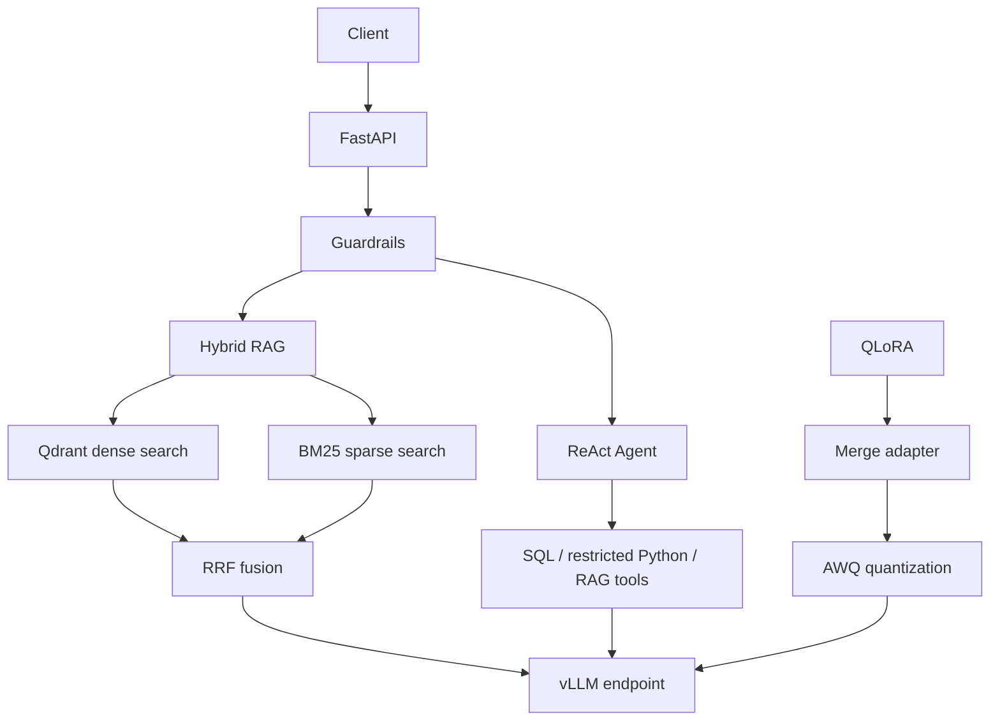

# Production-Ready LLM Capstone

An end-to-end LLM application combining hybrid RAG, QLoRA fine-tuning, AWQ quantization, a ReAct agent, guardrails, FastAPI, vLLM, evaluation, and load testing.

## Architecture



## Features

- PDF, DOCX, and Markdown ingestion with semantic chunking.
- Dense retrieval with Qdrant, sparse BM25 retrieval, and Reciprocal Rank Fusion.
- Real inference through a vLLM OpenAI-compatible endpoint.
- Bounded ReAct agent with `rag_search`, read-only `sql_query`, and restricted `python_exec` tools.
- Prompt-injection guardrails, PII redaction, secure error responses, and blocked-request logging.
- QLoRA training, adapter merge, AWQ quantization, FastAPI, Docker Compose, RAGAS evaluation, and stress-test scripts.

## Run locally

Create `.env` from `.env.example`, configure the model and services, then run on a GPU-enabled Linux host:

```bash
docker compose --profile gpu up --build -d
curl http://localhost:8000/healthz
curl http://localhost:8000/readyz
```

Swagger UI: `http://localhost:8000/docs`.

Ingest a document and query it:

```bash
curl -X POST http://localhost:8000/v1/ingest -F "files=@data/documents/llm_systems.md"
curl -X POST http://localhost:8000/v1/query \
  -H "Content-Type: application/json" \
  -d '{"question":"Why combine BM25 with dense retrieval?","top_k":5}'
```

See `docs/API.md`, `docs/ARCHITECTURE.md`, and `docs/DEMO_SCRIPT.md` for details.

## Model workflow

Training, merging, and quantization run separately on a compatible CUDA GPU:

```bash
python scripts/train_qlora.py --model Qwen/Qwen2.5-3B-Instruct --data training/instruction_dataset.jsonl --output artifacts/qlora-adapter --epochs 1 --max-seq-length 1024
python scripts/merge_adapter.py --adapter artifacts/qlora-adapter --output artifacts/merged-model
python scripts/quantize_awq.py --model artifacts/merged-model --output models/merged-awq --calibration-data training/instruction_dataset.jsonl --samples 8
python scripts/verify_model.py models/merged-awq
```

## Validation performed on Kaggle

- QLoRA training completed; adapter saved. The run used 8 examples and one optimizer step, so it validates the pipeline rather than meaningful domain adaptation.
- Adapter merged successfully; AWQ/compressed-tensors checkpoint saved (about 1.93 GiB) and metadata verified.
- vLLM served the quantized model and returned a real completion.
- FastAPI readiness passed; one Markdown file was ingested into 30 chunks; hybrid RAG returned 5 citations; prompt injection was blocked with HTTP 400.
- Agent tools were verified individually: Python calculation, read-only SQL query, and RAG search.
- Stress test: 12/12 successful requests at concurrency 2; throughput 0.908 requests/sec; mean latency 2,060 ms; p95 2,957 ms; p99 3,441 ms.

### Initial RAGAS result

Six-question evaluation using the local quantized model as judge:

| Metric | Score |
|---|---:|
| Context Precision | 0.3333 |
| Context Recall | 0.6905 |
| Faithfulness | 0.0333 |
| Answer Relevance | 0.8366 |

Faithfulness is poor and the evaluation set is small. Treat these as preliminary results, not proof of production-level quality. Improve the corpus, evaluation set, and judge before claiming a quality target.

## Limitations and submission

Guardrails are baseline heuristics, not a complete safety classifier. The SQL tool uses demo data. The short load test does not establish production capacity. Keep `.env`, tokens, private documents, databases, and model weights out of Git history. Save Kaggle model artifacts and reports to persistent storage before the notebook session ends.

Before submission, see `docs/FINAL_SUBMISSION_CHECKLIST.md`. Include real evaluation reports, load-test output, deployment screenshots, and a Loom/YouTube demo. Do not claim a metric or deployment result that was not measured.
